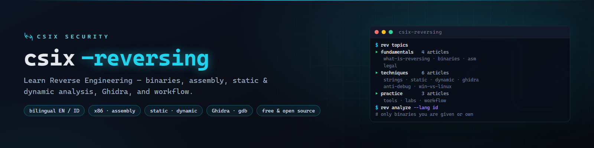

# csix-reversing



**Basis belajar reverse engineering gratis dua bahasa (EN/ID) — binaries, assembly, analisis statis & dinamis, Ghidra, konsep anti-debug, tool, lab, dan alur kerja.**

[](https://github.com/siedysoes/csix-reversing/actions/workflows/ci.yml)
[](LICENSE)
[](https://siedysoes.github.io/csix-reversing/)

`csix-reversing` adalah basis pengetahuan yang terstruktur dan ramah pemula
untuk belajar Reverse Engineering — artikel pendek, praktis, dan saling
terhubung yang menjelaskan cara binaries bekerja, cara menganalisisnya secara
statis dan dinamis, dan di mana berlatih.

> ⚠️ **Hanya binaries yang diberikan atau milik Anda sendiri.** Semua di sini
> tentang memahami software yang Anda berwenang menganalisisnya — program
> milik Anda, latihan lab, crackme, dan tantangan CTF. Jangan pernah
> me-reverse software yang tidak Anda hak untuk dipelajari.

> 🌐 **Baca di web:** **https://siedysoes.github.io/csix-reversing/**

## Isi

### Fundamental (4 artikel)

| Artikel | Yang akan Anda pelajari |
|---------|-------------------------|
| [Apa Itu Reverse Engineering](id/fundamentals/what-is-reversing.md) | Definisi, siapa yang melakukannya, kegunaan sah, etika |
| [Cara Binaries Bekerja](id/fundamentals/how-binaries-work.md) | Kompilasi, struktur ELF/PE, section, entry point |
| [Dasar Assembly](id/fundamentals/assembly-basics.md) | Register, mov/cmp/jump, stack — esensi x86 |
| [Hukum & Etika](id/fundamentals/legal-ethics.md) | Analisis berizin, hukum DRM, batas profesional |

### Teknik (6 artikel)

| Artikel | Yang akan Anda pelajari |
|---------|-------------------------|
| [String & Pola](id/techniques/strings-patterns.md) | strings, grep, magic bytes — 10 detik pertama |
| [Analisis Statis](id/techniques/static-analysis.md) | Menganalisis tanpa menjalankan: import, xref, control flow |
| [Analisis Dinamis](id/techniques/dynamic-analysis.md) | Berjalan di gdb/strace, breakpoint, observasi |
| [Decompiler & Ghidra](id/techniques/decompilers.md) | Membaca C hasil dekompilasi, alur Ghidra, batasnya |
| [Anti-Debug & Packing](id/techniques/anti-debug.md) | Apa itu, cara dikenali — secara konseptual |
| [Binaries Windows vs Linux](id/techniques/windows-vs-linux.md) | PE vs ELF, import, calling convention |

### Latihan & Sumber Daya (3 artikel)

| Artikel | Yang akan Anda pelajari |
|---------|-------------------------|
| [Tool Reverse Engineering](id/practice/reversing-tools.md) | Tabel tool per tugas, tips setup, caveat verifikasi |
| [Latihan & Lab](id/practice/labs.md) | crackmes, picoCTF, wargame — di mana berlatih |
| [Alur Kerja Reverse](id/practice/workflow.md) | Metode ujung-ke-ujung: triage → analisis → laporan |

Setiap artikel tersedia dalam **English** (`en/`) dan **Bahasa Indonesia** (`id/`).

## Baca di web

Situsnya adalah aplikasi statis satu halaman (tanpa server, tanpa pelacakan)
yang dijalankan GitHub Pages — merender file Markdown dari repo ini secara langsung:

- 🌐 **https://siedysoes.github.io/csix-reversing/**
- Tombol ganti bahasa **EN ↔ ID** di bar atas
- Kotak pencarian memfilter topik saat Anda mengetik
- Link di dalam artikel navigasi tanpa reload halaman

## Struktur repositori

```
csix-reversing/
├── index.html        # cangkang aplikasi web
├── app.js            # router + pencarian + ganti bahasa
├── style.css         # tema gelap
├── topics.json       # manifest topik (judul + jalur, EN/ID)
├── assets/           # banner
├── en/               # artikel English
│   ├── fundamentals/
│   ├── techniques/
│   └── practice/
├── id/               # artikel Indonesia
│   ├── fundamentals/
│   ├── techniques/
│   └── practice/
└── .github/workflows # CI: validasi link + manifest
```

## Berlatih dengan aman

- Reverse hanya binaries yang Anda miliki, diberikan, atau berwenang
  menganalisisnya (VM lab, crackme, tantangan CTF — lihat
  [panduan home lab CSIX Wiki](https://siedysoes.github.io/csix-wiki/#/en/practical/hands-on-lab)).
- Versi dan fitur tool bisa berubah — cocokkan detail terkini di dokumentasi
  resmi sebelum mengandalkannya.

## Berkontribusi

1. Fork, lalu tambah/ubah Markdown di `en/` (dan terjemahkan di `id/`).
2. Daftarkan topik baru di `topics.json` (kedua bahasa).
3. Buka pull request — CI memastikan semua link dan entri manifest valid.

Gaya artikel: Markdown murni, tanpa front matter, baris pertama `# Judul`,
diakhiri satu bagian `## Lihat juga` berisi link relatif.

## Bahasa

- [English](README.md)
- Bahasa Indonesia (file ini)

## Lisensi

MIT — lihat [LICENSE](LICENSE). Konten bebas dipelajari, dibagikan, dan
diadaptasi dengan atribusi.
