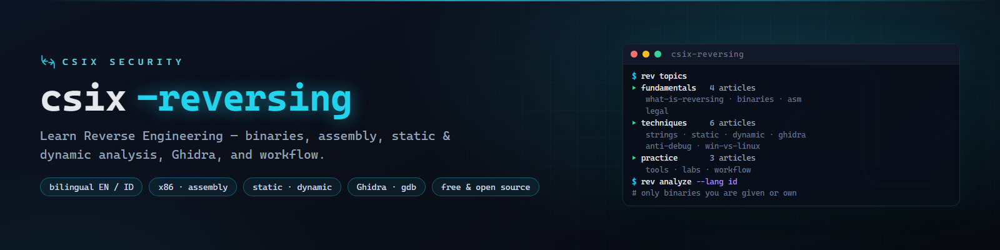

# csix-reversing



**Free bilingual (EN/ID) reverse engineering learning base — binaries, assembly, static & dynamic analysis, Ghidra, anti-debug concepts, tools, labs, and workflow.**

[](https://github.com/siedysoes/csix-reversing/actions/workflows/ci.yml)
[](LICENSE)
[](https://siedysoes.github.io/csix-reversing/)

`csix-reversing` is a structured, beginner-friendly knowledge base for learning
Reverse Engineering — short, practical, cross-linked articles covering how
binaries work, how to analyze them statically and dynamically, and where to
practice.

> ⚠️ **Only binaries you are given or own.** Everything here is about
> understanding software you are authorized to analyze — your own programs,
> lab exercises, crackmes, and CTF challenges. Never reverse-engineer software
> you have no right to study.

> 🌐 **Read it on the web:** **https://siedysoes.github.io/csix-reversing/**

## What's inside

### Fundamentals (4 articles)

| Article | You'll learn |
|---------|--------------|
| [What Is Reverse Engineering](en/fundamentals/what-is-reversing.md) | Definition, who does it, legitimate uses, ethics |
| [How Binaries Work](en/fundamentals/how-binaries-work.md) | Compilation, ELF/PE structure, sections, entry points |
| [Assembly Basics](en/fundamentals/assembly-basics.md) | Registers, mov/cmp/jump, stack — x86 essentials |
| [Legal & Ethics](en/fundamentals/legal-ethics.md) | Authorized analysis, DRM laws, professional boundaries |

### Techniques (6 articles)

| Article | You'll learn |
|---------|--------------|
| [Strings & Patterns](en/techniques/strings-patterns.md) | strings, grep, magic bytes — the first 10 seconds |
| [Static Analysis](en/techniques/static-analysis.md) | Analyzing without running: imports, xrefs, control flow |
| [Dynamic Analysis](en/techniques/dynamic-analysis.md) | Running under gdb/strace, breakpoints, observation |
| [Decompilers & Ghidra](en/techniques/decompilers.md) | Reading decompiled C, Ghidra workflow, limits |
| [Anti-Debug & Packing](en/techniques/anti-debug.md) | What they are, how they're recognized — conceptual |
| [Windows vs Linux Binaries](en/techniques/windows-vs-linux.md) | PE vs ELF, imports, calling conventions |

### Practice & Resources (3 articles)

| Article | You'll learn |
|---------|--------------|
| [Reversing Tools](en/practice/reversing-tools.md) | Tool table by task, setup tips, verify caveats |
| [Practice & Labs](en/practice/labs.md) | crackmes, picoCTF, wargames — where to practice |
| [The Reversing Workflow](en/practice/workflow.md) | End-to-end method: triage → analyze → report |

Every article exists in **English** (`en/`) and **Indonesian** (`id/`).

## Read on the web

The site is a static single-page app (no server, no tracking) served by
GitHub Pages — it renders the Markdown files from this repo live:

- 🌐 **https://siedysoes.github.io/csix-reversing/**
- Language toggle **EN ↔ ID** in the top bar
- Search box filters topics as you type
- In-article links navigate without page reloads

## Repository layout

```
csix-reversing/
├── index.html        # web app shell
├── app.js            # router + search + language toggle
├── style.css         # dark theme
├── topics.json       # topic manifest (titles + paths, EN/ID)
├── assets/           # banner
├── en/               # English articles
│   ├── fundamentals/
│   ├── techniques/
│   └── practice/
├── id/               # Indonesian articles
│   ├── fundamentals/
│   ├── techniques/
│   └── practice/
└── .github/workflows # CI: link + manifest validation
```

## Practice safely

- Reverse only binaries you own, were given, or are authorized to analyze
  (lab VMs, crackmes, CTF challenges — see the
  [CSIX Wiki home lab guide](https://siedysoes.github.io/csix-wiki/#/en/practical/hands-on-lab)).
- Tool versions and features change — verify current details on official
  docs before relying on them.

## Contribute

1. Fork and add/edit Markdown under `en/` (and translate under `id/`).
2. Register new topics in `topics.json` (both languages).
3. Open a pull request — CI checks that all links and manifest entries resolve.

Article style: pure Markdown, no front matter, `# Title` first line,
one `## See also` section with relative links at the end.

## Languages

- English (this file)
- [Bahasa Indonesia](README.id.md)

## License

MIT — see [LICENSE](LICENSE). Content is free to learn from, share, and adapt
with attribution.
